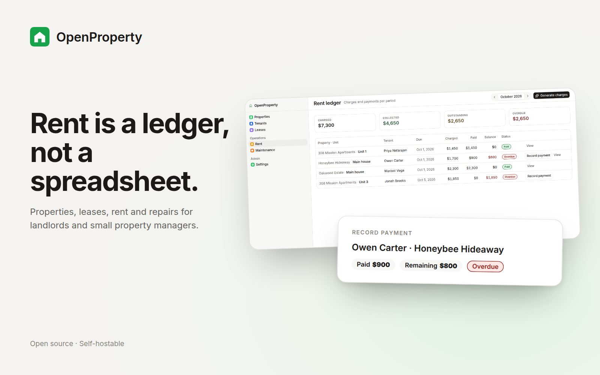
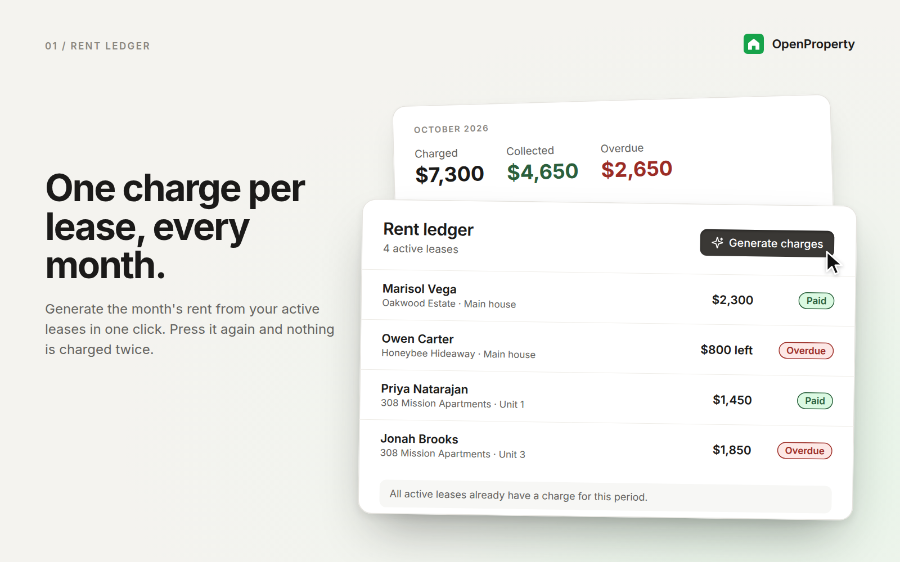
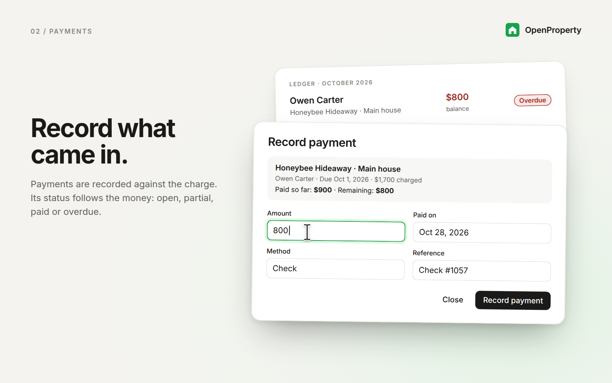
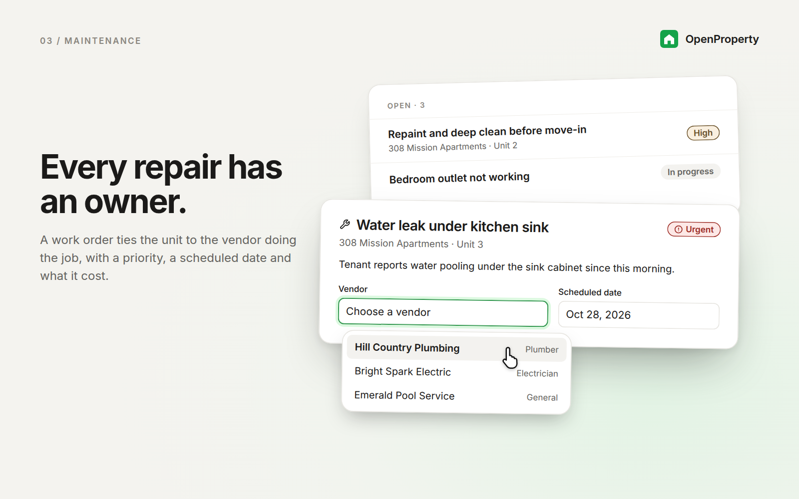
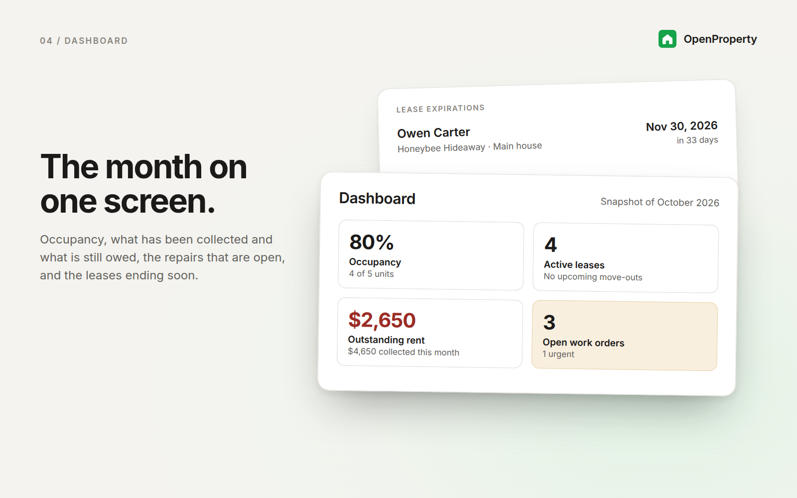

<picture>
  <source media="(prefers-color-scheme: dark)" srcset="readme-banner-dark.png" />
  
</picture>

# OpenProperty

Property management for landlords and small property managers: properties and
units, tenants and leases, a monthly rent ledger, and maintenance work orders
with your vendors.

An open-source app template provided by [Clawnify.com](https://clawnify.com).

**Rent is a ledger, not a spreadsheet.** Every active lease gets one charge per
month, generated with one click and never twice. Payments are recorded against
the charge, and its status follows from the money: open, partial, paid or
overdue. "Who owes what this month" is a filter, not an afternoon.

[](https://app.clawnify.com/deploy?repo=clawnify/OpenProperty)

## See it in action

Conceptual UI illustrations of the app's main capabilities, with fictional
example data. Open an image to see the details.

| Rent ledger | Payments |
| --- | --- |
| [](previews/ledger.png) | [](previews/payment.png) |
| **Maintenance** | **Dashboard** |
| [](previews/maintenance.png) | [](previews/dashboard.png) |

## What it does

- **Dashboard.** Occupancy, active leases, rent collected and outstanding this
  month, overdue totals, open and urgent work orders, and the leases ending
  soon.
- **Properties and units.** Each property shows its type, address, occupancy
  and its open work orders. A unit tracks bedrooms, bathrooms, size, market rent
  and status: vacant, occupied, turnover or unavailable.
- **Tenants.** A searchable list showing each tenant's current unit, and a
  detail page with contact details, employer, income, emergency contact and
  lease history.
- **Leases.** Term, monthly rent, deposit, due day, late fee and status
  (upcoming, active, ended, cancelled). A lease can have more than one tenant.
- **Rent ledger.** Step through months, generate the month's charges, record
  payments by amount, method, date and reference, and see what was charged,
  collected, outstanding and overdue. Generating again adds only the leases that
  were missing.
- **Maintenance.** Work orders with priority and status, linked to a property,
  unit, tenant and vendor, with a scheduled date and a cost.
- **Vendors and policy.** A vendor directory by trade, plus the defaults new
  leases start from: rent due day, late fee, grace days and currency.

A first run seeds three sample properties, five units and three vendors, so the
app is usable before you add anything. Deleted sample data does not come back on
a redeploy.

## What it deliberately doesn't do

- **Take payments.** There is no card or bank processing. The ledger records
  money that arrived some other way.
- **Screen applicants.** Applications are records you keep. There is no credit
  or background check.
- **Message tenants.** No SMS, email blasts or automated texts.
- **Publish anything.** No listing syndication, and no public tenant or owner
  portal.

Each of these can be built on top once you have your own copy.

## Running it locally

```bash
pnpm install
pnpm dev          # UI on :5173, API on :8787, schema applied to a local database
pnpm typecheck
pnpm build
```

## Stack

React 19, Vite and TypeScript on the client, with Tailwind CSS v4 and shadcn/ui.
A Hono API on the server, and a SQLite database. The same code runs locally and
in production.

## Data

One SQLite database per install. The schema is `src/server/schema.sql`. Defaults
and sample data are written by the app on first run, not by the schema.

| Table | Holds |
|---|---|
| `properties` | buildings, with type, address and a colour tag |
| `units` | rentable spaces inside a property, with rent and status |
| `tenants` | people, with contact, employment and emergency details |
| `leases` | a unit, its primary tenant, term, rent, deposit and late fee |
| `lease_tenants` | the other tenants on a lease |
| `rent_charges` | one charge per lease per month, with what has been paid |
| `payments` | money recorded against a charge |
| `vendors` | contractors by trade |
| `work_orders` | maintenance jobs, with priority, status, vendor and cost |
| `applications` | applicants and where they are in the decision |
| `settings` | rent policy defaults and currency |

## Project layout

```
src/
  server/
    index.ts        API routes for every entity, first-run data
    db.ts           database adapter (query / get / run)
    schema.sql      tables and indexes
  client/
    app.tsx         shell and routing
    components/     dashboard, properties, tenants, leases, rent,
                    maintenance, settings, and shadcn/ui primitives
    hooks/          router and app state
    lib/utils.ts    colours, dates, money and period helpers
```

## Licence

MIT. See [LICENSE](LICENSE).
